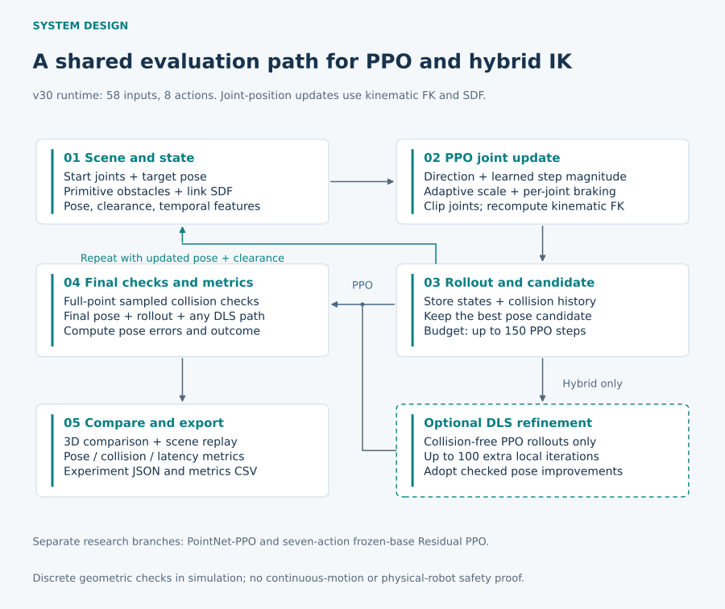

# Reinforcement Learning-Based Inverse Kinematics and Obstacle Avoidance for a 7-DoF Robotic Arm

**From Learning to Reach, to Learning to Move Safely**

A robotics research and engineering project developed during my algorithm internship at **SIASUN**, using a **Franka Panda** model. The goal was to preserve accurate end-effector pose control while moving a redundant arm around obstacles—and make the resulting solvers efficient enough to inspect and compare interactively.

**My contribution:** algorithm and reward development, failure diagnosis, geometric action regulation, DLS integration, evaluation, and computational optimization. I independently developed the final evaluation application on the supervising team's initial framework. [Team and third-party contributions](docs/contributions.md)

## Selected outcomes

| Engineering question | Measured outcome | Conditions |
|---|---|---|
| Can local refinement improve learned IK? | **84.4% → 88.1%** trajectory-safe success | v15 PPO / PPO + DLS; same **764 obstacle-containing cases**; seed 2026; up to 100 extra DLS iterations |
| Can the same policy solve faster? | **160.76 → 57.75 ms** mean complete solve time (**2.78×**) | v16; **90 mixed scenes**, including 21 without obstacles; fixed NumPy policy and 256-point inference budget |
| How reliable is the integrated policy? | **87.3% / 85.2%** trajectory-safe success | v30 best; **1,000 obstacle cases per seed**, 2026 / 30303; recorded-trajectory collision **7.9%** for both |

Here, **trajectory-safe success** requires position error <10 mm, orientation error <10°, and zero terminal or recorded-trajectory obstacle collisions. These are separate simulation experiments, not one continuous improvement curve. [Results and protocols](docs/experimental_results.md)

**[▶ Watch the original simulation recording — 37 seconds](assets/media/robot_arm_simulation.mp4)**

The unedited historical recording shows the RL/DLS comparison, obstacle scenes, and on-screen pose/collision metrics. Its exact checkpoint is not identified; it illustrates the software rather than establishing the benchmark results above. [Demo context](demo/README.md)

## The challenge: a correct pose can still hide an unsafe motion

Seven joints provide flexibility for a six-dimensional pose task, but the elbow, wrist, and hand must also clear obstacles. A numerical IK solution does not, by itself, establish a safe connecting motion. A learned policy faces the same tension: progress toward the target can conflict with avoidance and final precision.

I treated this as a sequence of engineering questions: **what failed, what caused it, what should change, and how could the change be checked?**

## Research decisions

**Learn to reach, then examine what reaching misses.** I established PPO-based pose IK and explored PointNet-PPO and frozen-policy residual corrections. Synthetic obstacle point clouds added geometric information, but did not automatically produce reliable avoidance. Action saturation and weak safety gains prompted paired diagnostics of action composition, representation, rewards, and training settings.

**Assign geometry and local refinement explicit roles.** I investigated signed-distance (SDF) clearance, historical Jacobian safety-direction features, joint-wise braking, and adaptive step sizes. Collision-checked DLS then addressed remaining pose error. In the paired v15 experiment, refinement improved convergence while retaining the original motion's collision history; it did not remove the 57 recorded collision episodes.

**Make repeated solving practical.** Profiling showed that geometry and environment work dominated an early CPU loop. I explored ONNX Runtime, then optimized NumPy FK/SDF processing, inactive-obstacle handling, and point transformations. The fixed-policy benchmark recorded no trajectory or evaluated-outcome differences across **132 tested scenes**. [Optimization study](docs/engineering_optimization.md)

**Later waypoint assistance.** I subsequently introduced intermediate waypoints to improve convergence and avoidance. Its approximately **93%** reported simulation success remains **applicant-reported and unverified** because the code and original evaluation are absent from this archive. It is excluded from the measured outcomes above.

[Explore the six-stage research journey, including unsuccessful experiments](docs/research_journey.md).

## Integrated solver

PointNet and the earlier seven-action residual controllers are separate research branches. The integrated application uses structured geometric observations and a later risk-sensitive step head; it does not enable every historical safety feature. [Methodology](docs/methodology.md)

## From algorithms to an inspection tool

The final application compares **PPO, PPO + DLS, DLS, and null-space avoidance** in the same scene. It supports obstacle configuration, 3D trajectory playback, position/orientation errors, terminal and sampled-trajectory collision metrics, scene save/load, and JSON/CSV export.

This made failures inspectable and individual scenes repeatable. The two robot views compare methods; they do not represent dual-arm coordination. [Demo overview](demo/README.md)

## Explore the project

- [Research journey](docs/research_journey.md) — hypotheses, setbacks, and design choices
- [Methodology](docs/methodology.md) — observations, actions, rewards, and solver flow
- [Experimental results](docs/experimental_results.md) — paired comparisons, versions, and negative results
- [Engineering optimization](docs/engineering_optimization.md) — profiling and fixed-policy timing
- [Contributions](docs/contributions.md) · [Limitations](docs/limitations.md)

**Scope:** kinematic simulation and discrete sampled-state collision checks. Results do not establish torque-level dynamic control, continuous collision safety, or real-robot deployment. This documentation draft distributes no original robot-project source, weights, internal logs, or vendor assets.

