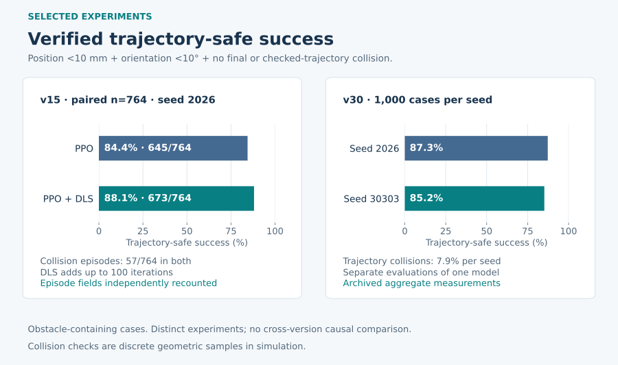
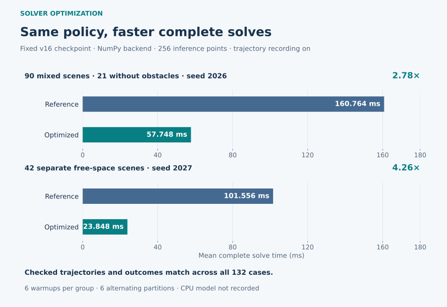

# Experimental Results

[Portfolio home](../README.md) · [Methodology](methodology.md)

The archived experiments support a complete simulation workflow: learned pose control, geometric obstacle handling, numerical refinement, and solver optimization. They also contain negative results that shaped subsequent experiments. This document reports each result with its own task, denominator, and evidence level.

**No result below is a physical-robot deployment result.** The figures summarize archived measurements; no training or benchmark was rerun to prepare this portfolio.

[Curated result data](../assets/data/verified_results.csv)

## 1. Definitions and evidence levels

| Metric | Meaning |
|---|---|
| Pose success | Final position and orientation satisfy the stated tolerances, regardless of earlier collisions |
| Terminal-safe success | Pose tolerances are met and the selected final configuration has no detected external-obstacle collision |
| Trajectory-safe success | Pose tolerances are met and neither the selected terminal configuration nor the checked trajectory samples has a detected collision |
| Trajectory collision rate | Fraction of episodes with at least one detected collision among checked samples |
| Mean solve latency | Wall-clock or solver-reported time under the specific experiment's timer boundary; not a control-loop frequency |

Collision metrics refer to the implemented geometric model and discrete samples. A collision-free recorded trajectory is not a proof about interpolated motion between samples.

Evidence is described at three levels:

- **Episode-level recheck:** stored per-episode fields support independent recounting of the reported outcome.
- **Archived measurement:** an existing aggregate JSON or stdout record supports the number, but does not allow every episode to be reconstructed from the retained artifact.
- **Unverified report:** a later description has no matching retained measurement. It is excluded from verified tables and figures.

The tables use stable experiment identifiers, with the model, denominator, and criterion supplied alongside each result. Raw logs and model weights are not included in this documentation package.

## 2. Base pose IK: precision depends on the criterion

**Experiment: `EXP-BASE-IK` · archived stdout measurement**

The early PyBullet evaluation solves 1,000 FK-generated targets from the home configuration with a 100-step budget and deterministic PPO inference. This is a no-obstacle experiment.

| Criterion | Successful targets | Rate |
|---|---:|---:|
| Position <5 mm and orientation <10° | 902 / 1,000 | 90.2% |
| Position <5 mm and orientation <15° | 939 / 1,000 | 93.9% |
| Position <20 mm and orientation <10° | 920 / 1,000 | 92.0% |

The same stdout records mean solve time of 28.7 ms, median 19.1 ms, and P95 93.2 ms. The script uses CPU policy inference and a timer around the policy/environment iteration loop after warmup; the retained record does not identify an exact CPU model. Per-target timing arrays are not retained in this artifact, so these are reported measurements rather than an independent timing reanalysis.

The 93.9% entry uses a looser orientation tolerance. It does not establish 93.9% multi-obstacle success, and it is not evidence for a later waypoint method.

## 3. Geometric PPO and hybrid refinement

### v15: recounting a historically mixed benchmark

**Experiment: `EXP-HYBRID-V15` · episode-level recheck · seed 2026**

The historical group labeled “obstacles” contains 1,000 episodes, including 236 with no obstacles. Reporting all 1,000 as obstructed scenes would misstate the denominator. The table separates the mixed group, its 764 genuinely obstructed cases, and an additional free-space group.

All success entries below require position error <10 mm, orientation error <10°, and the stated collision condition.

| Group | Method | Terminal-safe success | Trajectory-safe success | Episodes with a trajectory collision |
|---|---|---:|---:|---:|
| Historical mixed group, n=1,000 | PPO | 864 / 1,000 (86.4%) | **863 / 1,000 (86.3%)** | 57 / 1,000 (5.7%) |
| Historical mixed group, n=1,000 | PPO + DLS | 912 / 1,000 (91.2%) | **903 / 1,000 (90.3%)** | 57 / 1,000 (5.7%) |
| Obstructed subset, n=764 | PPO | — | **645 / 764 (84.4%)** | 57 / 764 (7.5%) |
| Obstructed subset, n=764 | PPO + DLS | — | **673 / 764 (88.1%)** | 57 / 764 (7.5%) |
| Separate free-space group, n=1,000 | PPO | 886 / 1,000 (88.6%) | **886 / 1,000 (88.6%)** | 0 / 1,000 |
| Separate free-space group, n=1,000 | PPO + DLS | 961 / 1,000 (96.1%) | **961 / 1,000 (96.1%)** | 0 / 1,000 |

The hybrid adds 40 trajectory-safe successes in the mixed group and 28 within the obstructed subset. Its additional DLS budget is up to 100 iterations, so the accuracy gain comes with additional computation. Equal recorded collision counts are an observation for this experiment, not a general guarantee that refinement cannot introduce a collision.

### v30: later deployment-model evaluation

**Experiment: `EXP-DEPLOY-V30` · archived aggregate measurements**

The later pure-PPO evaluation uses the v30 risk-step-head checkpoint, a rollout limit of 150, a time-feature denominator of 100, and 256 inference points. Each seed has a separate 1,000-case obstacle group and a separate 1,000-case free-space group.

| Seed | Group | Terminal-safe success | Trajectory-safe success | Trajectory collision rate |
|---:|---|---:|---:|---:|
| 2026 | Obstacle group, n=1,000 | 87.6% | **87.3%** | **7.9%** |
| 30303 | Obstacle group, n=1,000 | 85.6% | **85.2%** | **7.9%** |
| 2026 | Free space, n=1,000 | 93.9% | **93.9%** | 0% |
| 30303 | Free space, n=1,000 | 93.5% | **93.5%** | 0% |

The files retain aggregate results rather than the full per-episode records used in the v15 recount. Their obstacle-group values are therefore reported as archived aggregates. Two seeds describe sensitivity to these sampled scene sets; they do not establish generalization to every obstacle distribution.

The v15 and v30 tables use different checkpoints, horizons, features, and evaluation artifacts. They show the scope of the engineering progression, but do not isolate the causal benefit of a risk head, braking, curriculum, or any other individual change.

## 4. Residual learning and negative results

**Experiment family: `EXP-RESIDUAL-DEV` · episode-level recheck for the table below**

The PyBullet branch evaluates a frozen base PPO, a capped-step variant, a cap-trained residual PPO, and a learned candidate scorer on the same 1,000 development scenes. The seed range is 2026081300–2026082299.

| Controller | Pose success, <20 mm / <15° | Trajectory-safe success at that tolerance | Episode collision rate | Trajectory-safe success, <10 mm / <10° |
|---|---:|---:|---:|---:|
| Frozen base PPO | 931 / 1,000 (93.1%) | 721 / 1,000 (72.1%) | 227 / 1,000 (22.7%) | 685 / 1,000 (68.5%) |
| Frozen base, step cap 0.10 | 919 / 1,000 (91.9%) | 701 / 1,000 (70.1%) | 248 / 1,000 (24.8%) | 644 / 1,000 (64.4%) |
| Cap-trained residual PPO, 40,960 steps | 928 / 1,000 (92.8%) | 707 / 1,000 (70.7%) | 245 / 1,000 (24.5%) | 655 / 1,000 (65.5%) |
| Learned candidate scorer | 918 / 1,000 (91.8%) | 699 / 1,000 (69.9%) | 245 / 1,000 (24.5%) | 646 / 1,000 (64.6%) |

The frozen policy's 93.1% pose rate includes episodes that collided. Its corresponding trajectory-safe rate is 72.1%, so this experiment cannot support a claim of “93% safe obstacle avoidance.”

Earlier paired residual diagnostics likewise do not establish improvement: initial Residual PPO records collision rate 22.5% versus 22.7% for the frozen base, while trajectory-safe success at <10 mm / <10° is 68.0% versus 68.5%. The stored paired tests do not distinguish these differences from sampling variation.

The useful outcome is an experimental diagnosis, not a higher headline score. Increasing residual authority, adding robot-centered geometry, changing reward/termination behavior, varying PPO optimization settings, and extending training did not produce a consistent verified safety advantage in the retained development results. A standalone PointNet-PPO success rate is not claimed because a matching retained formal evaluation was not found.

### Development-set boundary

Early Direct/Headroom, geometry, and relative-representation training schedules overlap the development seed range. Those runs are developmental comparisons, not independent unseen-scene tests. Later protocols separate training seeds from development and designate an additional holdout set; the retained protocol records that holdout as `LOCKED_UNSEEN`.

Repeated development-set use remains a limitation even after seed separation. The later candidate scorer has its own episode-disjoint supervised test split, but next-step prediction quality is not interchangeable with full-trajectory control success.

## 5. Solver optimization: complete-loop evidence

[Curated timing data](../assets/data/solver_optimization.csv)

### A paired test of the fast solver

**Experiment: `EXP-FAST-V16` · archived paired measurement and equivalence checks**

Both implementations use the same v16 checkpoint, configuration, NumPy policy backend, and 256 inference points. The timer surrounds the complete `solve(record_trajectory=True)` call. Six warmups per group precede six alternating-order partitions.

| Group | n | Original solver, mean | Optimized solver, mean | Observed ratio |
|---|---:|---:|---:|---:|
| Mixed group, including 21 zero-obstacle cases | 90 | 160.764 ms | **57.748 ms** | 2.78× |
| Separate free-space group | 42 | 101.556 ms | **23.848 ms** | 4.26× |

The stored comparison reports zero maximum differences in joint angles, trajectory samples, position error, and orientation error; iteration counts, collision labels, trajectory lengths, and strict outcomes also match. This supports a performance improvement for the tested solver path while preserving the checked outputs on these cases. It does not establish bitwise equivalence for every possible input or performance on unspecified hardware.

### ONNX Runtime and the 1,068.9 ms baseline

**Experiment: `EXP-ONNX-LEGACY` · archived aggregate measurement**

A separate historical benchmark uses a v16 speed-base policy with a v15 configuration, 768 geometry points, 200 cases per group, and ten warmups.

| Obstacle-labeled group | Mean solve time | Recorded success rate |
|---|---:|---:|
| SB3 | **1,068.947 ms** | 66.5% |
| ONNX Runtime FP32 | **672.254 ms** | 63.5% |
| ONNX Runtime INT8 | **691.336 ms** | 69.0% |

This record supports the existence of an approximately 1,068.9 ms historical baseline. It also shows that INT8 was not the fastest variant in that experiment and that solver outcomes changed across backends. The original aggregate success field is retained here as recorded; it is not relabeled as a freshly recomputed trajectory-safe rate.

The paired 57.748 ms result comes from a different experiment. Combining 1,068.9 ms with that endpoint would confound checkpoint, configuration, point resolution, implementation, and sample set. Exact CPU hardware is not established by these retained benchmark artifacts, so no hardware-normalized comparison is claimed.

## 6. Claims that remain unverified

**`REPORT-WAYPOINT`: later waypoint-guided performance near 93%.** This is a user-reported later outcome. A matching implementation, experiment protocol, and original result artifact were not available in the reviewed workspace. It is not included in verified performance tables, plotted as a measured result, or attributed to an implemented public module.

**A later 57.3 ms measurement.** The precise supporting record was not found. The verified paired endpoint is 57.748 ms, which rounds to 57.7 ms, not 57.3 ms. The statement “1,068.9 → 57.3 ms” is therefore not presented as a verified paired benchmark or an ONNX-only speedup.

## 7. Interpretation

The strongest supported engineering outcomes are a complete simulated IK evaluation workflow, collision-aware comparison of learned and numerical solvers, a documented hybrid refinement result, and a paired fast-solver optimization with preserved checked outputs. The negative residual results are part of that record: they demonstrate why pose accuracy, trajectory collision, and solver latency must be evaluated separately.

Selected browser demonstrations validate interaction and visualization. They do not estimate population success rates, replace the benchmark denominators above, or provide evidence of physical-robot operation.
