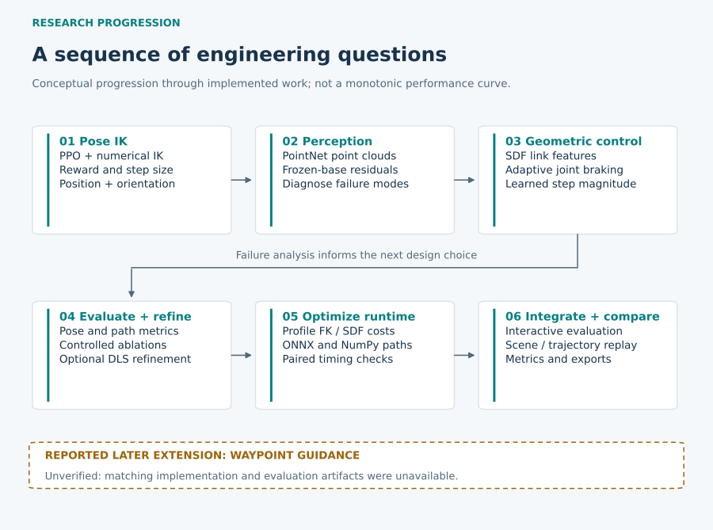

# From Learning to Reach, to Learning to Move Safely

[Project overview](../README.md) · [Methodology](methodology.md) · [Experimental results](experimental_results.md) · [Contributions](contributions.md)

This project grew from a practical question: how could a learned inverse-kinematics solver preserve pose accuracy while moving a redundant arm around obstacles? I explored that question during a robotics algorithm internship at SIASUN, starting from a task definition and initial software framework supplied by the supervising team.

The work eventually connected learning, geometric action regulation, numerical refinement, and an interactive evaluation application. The six stages below organize the decisions behind that system. They describe related lines of investigation; the archived branches overlap, and their results do not constitute a single chronological benchmark with steadily improving performance.

## 1. The challenge: reaching a pose while finding a safe motion

The simulation platform was a seven-joint Franka Panda arm. Its extra degree of freedom provides flexibility for a six-dimensional end-effector task, but it also leaves the solver with choices about how the rest of the arm moves. A small final pose error says little about whether the elbow, wrist, or hand passed through an obstacle.

Ordinary PPO-based IK and numerical IK provided the starting point. The task involved both position and orientation, with joint-angle increments as the learned controller's actions. Experiments used PyBullet and later MuJoCo/JAX environments; their joint states were updated kinematically. They did not demonstrate torque control or physical robot execution.

The key change in how I framed the problem was to evaluate **reaching and motion safety together**. I needed to inspect the recorded motion, distinguish terminal collisions from earlier collisions, and understand how a proposed action moved links other than the end effector. This distinction shaped the later learning objectives and evaluation software.

## 2. Obstacle-aware learning: PPO, PointNet-PPO, and residual corrections

One direct approach combined a PointNet encoder for synthetic obstacle point clouds with PPO. The intention was to let the policy learn reaching and avoidance together. During development, I found that this formulation struggled to retain dependable pose convergence. A matching formal evaluation is not retained, so I do not assign it a numerical success rate here. Providing a richer obstacle representation had not, by itself, made the control problem easier.

A separate residual-learning branch preserved an existing IK policy and trained a correction around its actions. This changed the question from relearning the whole controller to learning when and how to intervene. It also exposed a constraint: if the base policy already saturates an action component, a small residual can have little useful authority after clipping. Direct addition and a composition that used the remaining action range were therefore examined separately.

Paired diagnostics did not establish a consistent safety improvement for the tested residual policy. Some interventions rescued collisions, while others introduced failures into previously successful cases. Follow-up experiments explored action composition, geometry representation, reward design, learning rate, training duration, and intervention magnitude. These were useful negative results: they narrowed the explanation from “the policy needs more information” to questions about control authority, credit assignment, and behavior under closed-loop execution.

I kept the PointNet and residual branches distinct from the later structured-observation PPO solver. They represent alternative hypotheses, rather than components all operating inside the final application. The [results page](experimental_results.md) explains the development-set limitations of the residual experiments. **Evidence: `EXP-RESIDUAL-DEV`.**

## 3. Geometric regulation and hybrid refinement

The next set of decisions separated tasks that a single learned output had been asked to handle simultaneously.

**Make a successful detour worth learning.** In early reward formulations, repeatedly penalizing absolute pose error could make a long avoidance maneuver expensive. Early collision termination could then be attractive despite a collision penalty. Progress-based reward redesign addressed this incentive by rewarding improvement between successive states. Mixed-curriculum training retained obstacle-free reaching tasks while introducing harder obstacle scenes, addressing the loss of ordinary IK capability during avoidance training.

**Regulate the action using nearby geometry.** Analytical signed-distance functions measured clearance from sampled points on monitored links to box, sphere, and cylinder obstacles. Jacobian-derived safety-direction features were investigated in historical versions. Joint-wise braking used the clearance of downstream links to reduce the motion of joints that could move those links toward an obstacle. Adaptive step sizes also connected action magnitude to the task state. These mechanisms have different roles; the final configuration does not enable every historical direction feature or filter.

**Use a local numerical method for the remaining pose error.** The hybrid solver added damped least-squares refinement after the learned motion. Candidate updates were checked against obstacle geometry and reduced when necessary. Acceptance depended on collision checks and improvement in pose error. The original RL trajectory's collision history remained part of the result, even if the solver returned an earlier collision-free configuration.

A historical paired evaluation made this division of work measurable. On the same **764 obstacle-containing cases**, adding DLS increased trajectory-safe success from **645/764 (84.4%)** to **673/764 (88.1%)**. Both methods retained **57 recorded collision episodes**. The improvement came from bringing additional collision-free motions within the pose tolerance, rather than removing collisions from the preceding motion. DLS had up to **100 additional iterations**, so this was an added-refinement comparison with additional computation. **Evidence: `EXP-HYBRID-V15`.**

Here, trajectory-safe success means position error below **10 mm**, orientation error below **10°**, and no terminal or recorded-trajectory obstacle collision. The checks concern sampled configurations and sampled robot geometry. They do not certify continuous motion between samples or complete self-collision safety.

## 4. Waypoint-Assisted Improvement

I used a two-dimensional success-rate heatmap to examine how performance varied with the initial end-effector-to-target distance and initial orientation difference. The distribution was uneven. Within the same **120–130°** initial orientation-difference range, success was **89.7%** at **0.3–0.4 m**, compared with **75.0%** at **1.1–1.2 m**. This showed an association between greater initial distance and lower success in the sampled tasks; it did not establish that distance caused the failures.

That pattern led me to hypothesize that continuously pursuing a distant final target could make pose convergence and obstacle avoidance harder to balance. I wanted to test whether a more structured sequence of targets could make these difficult motions easier to solve.

I therefore introduced intermediate waypoints in a later research iteration, dividing longer target-reaching motions into smaller subgoals. My aim was to improve the stability of local solves and obstacle avoidance while progressing toward the final pose.

My project records report approximately **93% simulation success** for that later version. Its original code and complete evaluation records are not included in this repository, so this remains a reported project outcome rather than an independently revalidated benchmark. I do not treat it as a direct comparison with the separate v15 or v30 experiments.

## 5. Profiling the complete solver

Once repeated evaluation and interactive use became important, runtime became an engineering question of its own. I explored ONNX export and ONNX Runtime inference, then examined the cost of the complete solve. A faster network forward pass would only help so much if forward kinematics, point transformations, and repeated distance calculations dominated the call.

Profiling led to changes in geometry processing: skipping inactive obstacle slots, deferring nearest-direction calculations until needed, specializing quaternion rotation, fusing forward kinematics, and batching point rotation. The controlled comparison held the policy, NumPy inference backend, test scenes, and **256-point inference budget** fixed. It measured implementation changes without retraining the policy.

On **90 mixed scenes**, including **21 without obstacles**, mean complete solve time fell from **160.76 ms to 57.75 ms**, a **2.78× speedup**. Warmup was excluded and execution order was alternated across six batches. A separate set of **42 obstacle-free scenes** measured **101.56 ms to 23.85 ms**. The paired runs recorded no trajectory or evaluated-outcome differences across those tested cases. **Evidence: `EXP-FAST-V16`.**

These figures describe the fixed-policy NumPy geometry comparison. They are not an ONNX-only speedup, a browser rendering measurement, or evidence that all policies and scenes will behave identically. The [optimization document](engineering_optimization.md) separates backend exploration from the controlled timing result.

## 6. Turning the research into an evaluation application

I independently developed the final interactive simulation and evaluation application on top of the team's initial framework, integrating the solver work with third-party simulation and visualization tools. The purpose was to make both successful solutions and failures easy to inspect and revisit.

The application compares **PPO, PPO + DLS, DLS, and null-space avoidance** on a shared scene. Users can configure a target and obstacles, inspect the three-dimensional trajectory, examine pose errors and collision indicators, save and reload scenes, and export experiment JSON and metric CSV files. The two robot views compare methods; they do not represent cooperative dual-arm control.

The integrated application uses a later structured-observation PPO policy with a risk-sensitive step-size head. Its v30 evaluation is a separate experiment from the v15 hybrid comparison and the v16 timing study. Fixed demonstration scenes and interface checks establish software behavior, rather than population-level success rates. **Evidence: `EXP-DEPLOY-V30`.**

This final stage brought the earlier decisions into one inspectable workflow: define a scene, solve it, examine the entire returned motion, and retain enough information to revisit the case. The [demo plan](../demo/README.md) and [recording guide](../demo/recording_guide.md) describe how to show that workflow, while the [contribution statement](contributions.md) identifies my work, the team's starting framework, and the external tools and assets involved.

The project demonstrates simulation-based algorithm development and engineering integration. Physical robot trials, dynamics-aware control, continuous collision checking, and broader held-out evaluation remain future validation work. [Limitations](limitations.md)
